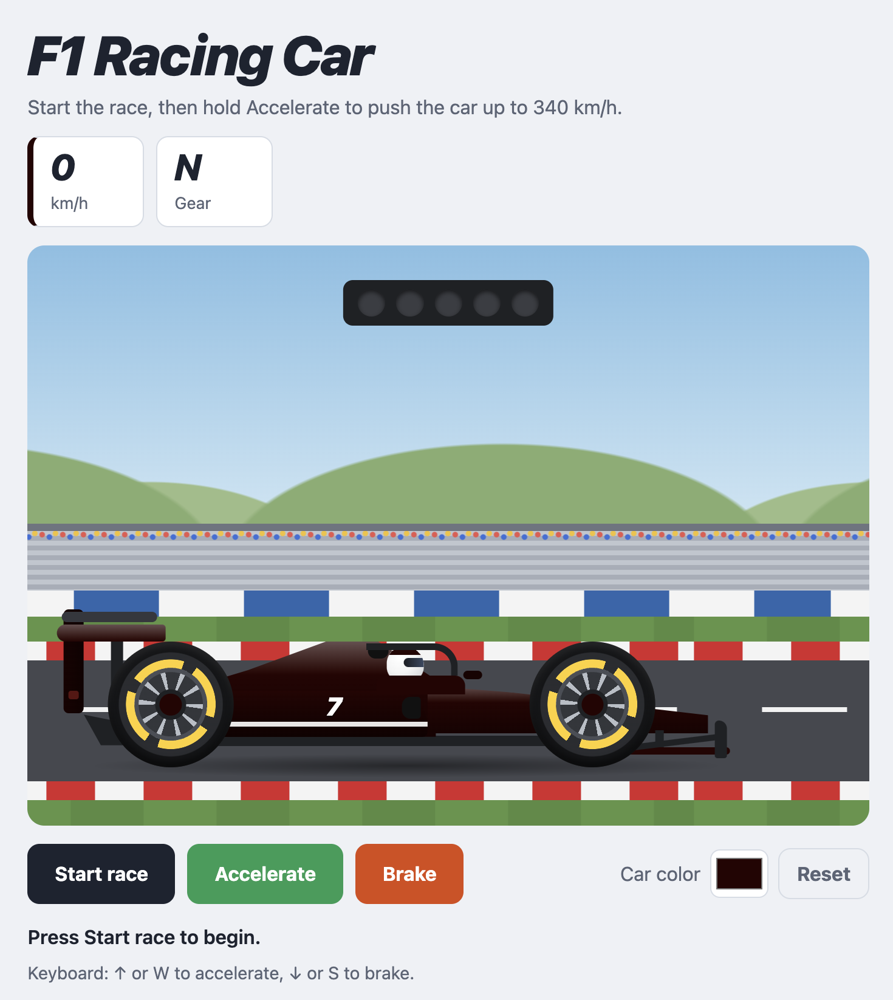
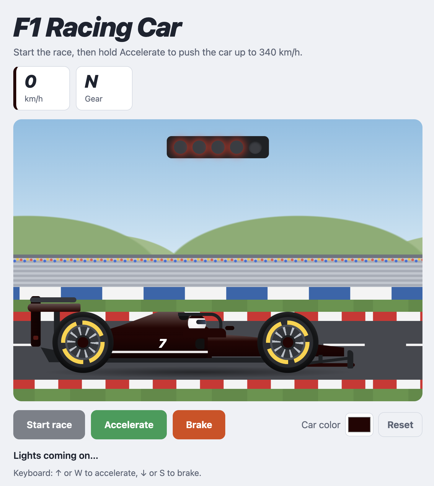
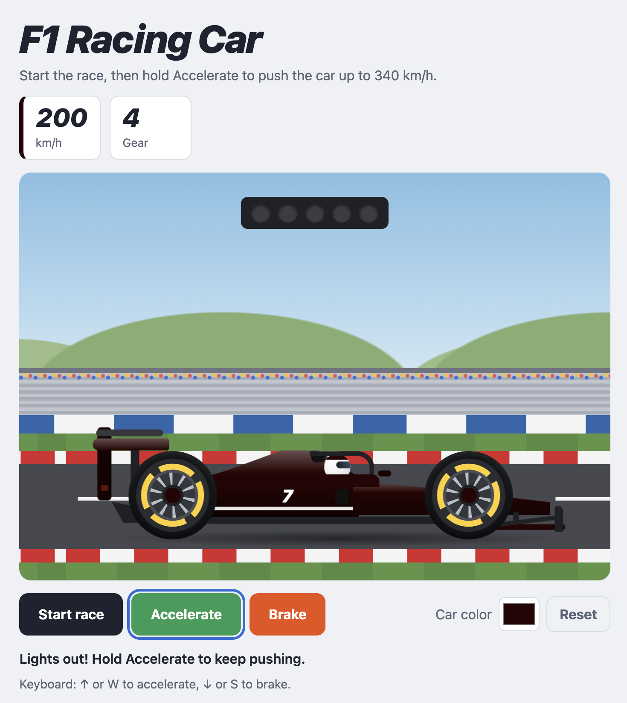

# F1 Racing Car

An animated Formula 1 car made with HTML, CSS, and JavaScript. Nginx serves the page from a small container, and Kubernetes runs two copies of it.

Press **Start race**. When the five lights go out, hold **Accelerate** or **Brake** (or use ↑/W and ↓/S).

## Screenshots

On the grid, before the start:



The start lights coming on:



Under power, at 200 km/h in 4th gear:



## Deploy to Kubernetes

You need `kubectl` and a cluster that can pull from Docker Hub.

Everything is in `kubernetes.yaml`: a Deployment and a Service. It runs **2 pods** of `aaqibshaikh199/argocd:car-racing-game`. The Service is a **NodePort on 30080**, which forwards to port 8080 in the container.

### 1. Apply the manifest

```bash
kubectl apply -f kubernetes.yaml
```

That creates both the Deployment and the Service. Kubernetes pulls the image if the node does not already have it.

### 2. Open the app

| Cluster | How to open it |
|---|---|
| Docker Desktop | http://localhost:30080 |
| minikube | `minikube service f1-racing-car --url` |
| Any cluster | `kubectl port-forward service/f1-racing-car 8080:80`, then http://localhost:8080 |

### 3. Check that it is running

```bash
kubectl get pods -l app=f1-racing-car
kubectl get service f1-racing-car
```

Both pods should show `Running` and `READY 1/1`.

### Remove it

```bash
kubectl delete -f kubernetes.yaml
```
